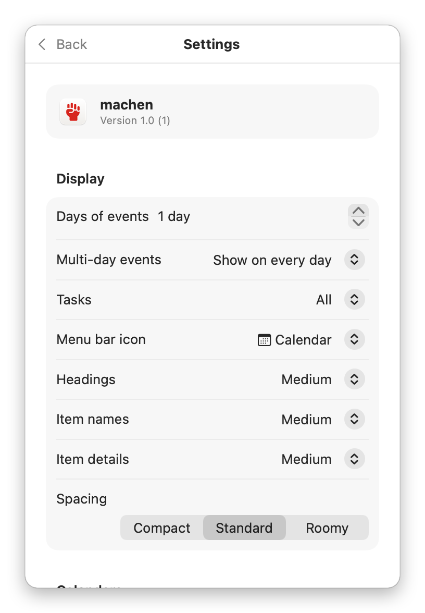

<p align="center">
  
</p>

# machen

A small macOS menu bar app for Google Calendar and Google Tasks.

<p align="center">
  
  
  
</p>

Click the icon in the menu bar to see:

- **Events** from every calendar you have visible in Google Calendar, for today or for the next several days (see Settings). Events use their own colour if you gave them one in Google Calendar, and their calendar's colour otherwise.
- **Open tasks**, grouped by task list. Each list has a colour bar, like calendar events do. Within a list, tasks are sorted by due date: overdue ones first (in red), undated ones last. Subtasks appear indented and in smaller type below their parent, in the order you gave them in Google Tasks.

You can add events and tasks with the **+** buttons. A list's own **+** adds a task to that list. To add a subtask, open a task and click **Add Subtask**. Click a task list's name to hide or show its tasks; a collapsed list shows how many tasks it holds (`Work 5 ›`). A task with subtasks shows their number at the right (`2 ▾`); click it to hide or show them. What you collapse is remembered. Click an event or task to edit or delete it. Click the circle next to a task to mark it as done; for a few seconds afterwards, **Undo** (or ⌘Z) reopens it, together with any subtasks completed with it. Events from calendars you can't edit open in Google Calendar instead.

Events with a video call (Google Meet, or a Zoom, Teams, Webex or similar link in the location or description) get a **Join** button, which turns blue from 10 minutes before the start. To move an event to another calendar, pick it in the editor. When you edit or delete a repeating event, choose **This event** or **All events**. With All events, a new time or date shifts the whole series by the same amount.

Requires macOS 14 or later.

## Install

Download the latest `machen-<version>.dmg` from the GitHub Releases page, open it, and drag **machen** to **Applications**. Start it, click the menu bar icon, and click **Sign in with Google**. Your browser opens. Approve access, then click the menu bar icon again.

Turn on **Settings → Launch at login** if you want machen to start automatically.

## Building it yourself

You need Xcode or the Command Line Tools (`xcode-select --install`).

### 1. Create a Google OAuth client (one time)

Every app that uses Google's APIs needs its own OAuth client. It's free and takes about five minutes.

1. Open <https://console.cloud.google.com/> and create a new project (for example "machen").
2. Go to **APIs & Services → Library** and enable both **Google Calendar API** and **Google Tasks API**.
3. Go to **Google Auth Platform** (or **APIs & Services → OAuth consent screen**):
   - Choose **External** as the user type and fill in the app name and your email.
   - Under **Audience**, add your own Google address as a **test user**.
4. Go to **Clients** (or **Credentials → Create credentials → OAuth client ID**), choose application type **Desktop app**, and create it.
5. Copy `Support/Config.example.plist` to `Support/Config.local.plist` and fill in the **Client ID** and **Client secret**. The file is gitignored. The build copies it into the app, so anyone using your build only has to sign in.

   Without this file, the app asks for a client ID and secret on first launch instead.

> **Publishing status:** while the Google project is in *Testing*, only the test users you listed can sign in, and Google expires their sign-in after 7 days. To let anyone sign in, go to **Audience** and click **Publish app**. Until Google verifies the app, it's limited to 100 users, and people see an "unverified app" warning once when they sign in (**Advanced → Go to machen**). To remove the warning, apply for verification on the same page. Google then asks for a home page, a privacy policy, and a short video of the sign-in.

### 2. Build and run

```bash
./build.sh
open build/machen.app
```

**Layout:** every spacing, size and font value of the main screen lives in `Support/layout.json`: row padding for each Spacing preset, heading paddings, indents, colour bars, and base font sizes. `build.sh` turns it into `Sources/machen/Layout.generated.swift` before compiling, so just edit the JSON and run `./build.sh`. A typo or wrong value stops the build and names the key or line. Keys starting with `_` are comments.

**Screenshots:** `Support/make-screenshots.sh` renders the images in `docs/screenshots` from the app's real views with sample data, so no personal calendar data ends up in the repository.

The app icon is drawn in code by `Support/make-icon.swift`. After changing it, run `swift Support/make-icon.swift` to regenerate `Support/AppIcon.icns`.

`build.sh` signs the app with the first **Developer ID Application** certificate in your keychain, or ad-hoc if you have none. Set `SIGN_IDENTITY` to choose a different one.

### 3. Make a notarized release

Apple has to notarize a downloaded app, or macOS refuses to open it. One-time setup: save your notarization credentials in the keychain. The command asks for an app-specific password, which you can create at <https://account.apple.com> under **Sign-In and Security**.

```bash
xcrun notarytool store-credentials machen-notary --apple-id <your Apple ID> --team-id <your team ID>
```

Then, for each release, bump `CFBundleShortVersionString` in `Support/Info.plist` and run:

```bash
./release.sh
```

This builds and signs the app, packs it into `build/machen-<version>.dmg`, and has Apple notarize it. Upload the `.dmg` to a GitHub release.

## Notes

- **Storage:** the sign-in token is stored in your macOS Keychain. A built-in client ID and secret live inside the app bundle; ones you enter yourself are stored in the app's preferences. (Google doesn't treat a Desktop client secret as confidential, but keep it out of the public repository anyway.)
- **Keychain prompt:** a Keychain item trusts the app that created it. machen recreates its item from the running build, so with a Developer ID signature it's tied to your team and later builds don't ask again. You may be asked once, when first switching from an ad-hoc build: click **Always Allow**. Ad-hoc builds ask after every rebuild.
- **Display:** clicking the **Events** heading switches between Today, 2 days, 3 days and Week. In **Settings → Display** you can choose any number of days of events to show (1 to 14) and the row spacing (Compact, Standard or Roomy). When more than one day is shown, events are grouped under day headings. The **Multi-day events** menu sets how events lasting more than a day are handled: show them on every day they cover, show each one once, or exclude them. With **Show on today and start day**, an event running today appears once under Today. An event that starts later in the shown days appears once, on its start day, marked "Starts". (A multi-day event is an all-day event longer than one day, or a timed event lasting 24 hours or more. An overnight event such as 22:00–06:00 doesn't count.)
- **Text size:** Settings → Display has three size menus, each with Small, Medium (the standard size), Large or Extra Large. They apply to events and tasks alike. **Headings** covers EVENTS and TASKS, the day headings and the list names. **Item names** covers event and task titles. **Item details** covers times, places, notes, due dates, and subtasks.
- **Tasks filter:** choose **All** or **Due date only**, either in Settings → Display or by clicking the **Tasks** heading in the main screen. With **Due date only**, a parent task without a date stays visible if one of its subtasks has a date.
- **Menu bar icon:** pick one of several icons in Settings → Display, including the fist from the app icon.
- **Links:** Settings has shortcuts to Google Calendar, Google Tasks, and this project on GitHub.
- **Choosing what's shown:** **Settings** (gear icon) lets you pick which calendars and task lists to show, and a colour for each task list. (Google Tasks lists have no colours of their own.) By default you see the calendars that are visible in Google Calendar, plus all task lists. Drag calendars and task lists by their handle (☰) to reorder them. Task lists appear in that order in the main screen. Calendar order decides which event comes first when several start at the same time. Reordering doesn't change a list's colour.
- **Offline:** machen keeps the last loaded calendars, events and tasks in `~/Library/Application Support/io.github.bernorieder.machen/cache.json`, readable only by you. It shows them right away at launch, and when you're offline. Signing out deletes the file.
- **Notifications:** machen shows a notification for each popup reminder you've set in Google Calendar: the event's own, or its calendar's defaults. It covers the calendars shown in machen, and adds a **Join** button for video calls. macOS asks for permission the first time. Turn them off in **Settings → General → Event notifications** if Google already notifies you elsewhere. machen looks up to 4 weeks ahead, Google's maximum, so reminders like "1 week before" work too. Notifications only come while machen is running: it removes pending ones when you quit, so nothing outdated fires while it's closed. After your Mac wakes up, machen refreshes right away.
- **Sync:** machen loads everything at launch, refreshes in the background whenever you open it (unless it just did), checks events every minute and everything else every 5 minutes, and refreshes after every edit. Each events check costs one request per shown calendar, so keep this in mind if many people share your Google project: its default quota is 1 million Calendar requests a day.
- **Limitations:**
  - Google Tasks only stores a due *date*, not a time.
  - Tasks can't be moved to another list after you create them.
  - A single occurrence of a repeating event can't be moved to another calendar; Google only moves whole series.
  - Repeating events offer *This event* and *All events*, not *This and following events*.
  - Subtasks can only be one level deep, which is a Google Tasks limit.
  - Completing a task also completes its open subtasks, like the Google Tasks apps do.

## Credits

The fist in the app icon and the menu bar is [hand-fist](https://fontawesome.com/icons/hand-fist?s=solid) from [Font Awesome Free](https://fontawesome.com) 6.7.2 by Fonticons, Inc., licensed under [CC BY 4.0](https://creativecommons.org/licenses/by/4.0/) (see `Support/hand-fist.svg`). The app icon tints it red and sets it on a white tile.

## Code layout

| File | Purpose |
| --- | --- |
| `GoogleAuth.swift` | OAuth 2.0 browser sign-in (PKCE + loopback redirect), token refresh, Keychain storage |
| `GoogleAPI.swift` | Authorized JSON requests and URL building |
| `Models.swift` | API types, display models, and edit drafts |
| `Store.swift` | Fetching, sorting, and saving events and tasks |
| `AgendaView.swift` | The main popover list |
| `Editors.swift` | Event and task editors |
| `SettingsViews.swift` | Sign-in and settings screens |
| `Layout.generated.swift` | Layout constants generated from `Support/layout.json` (don't edit) |
