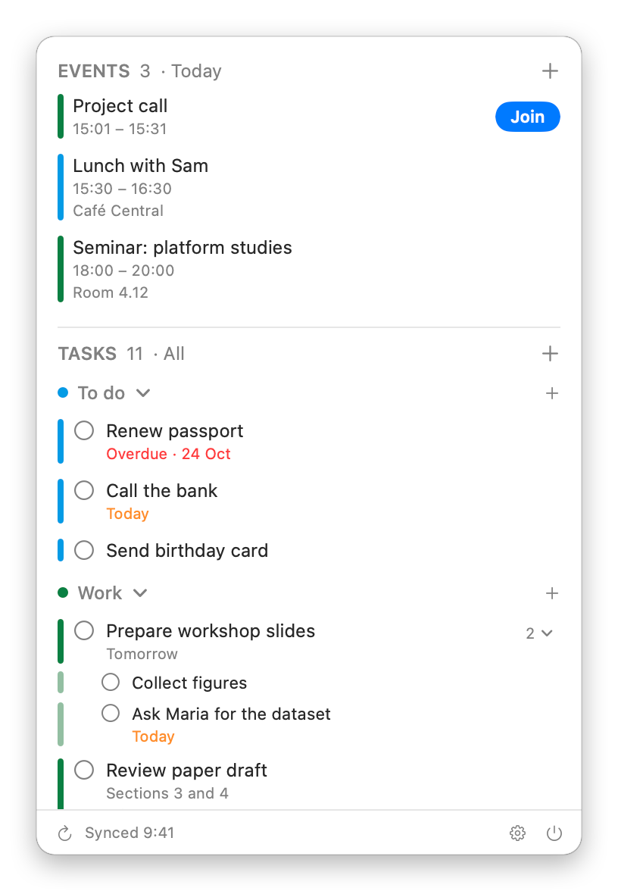
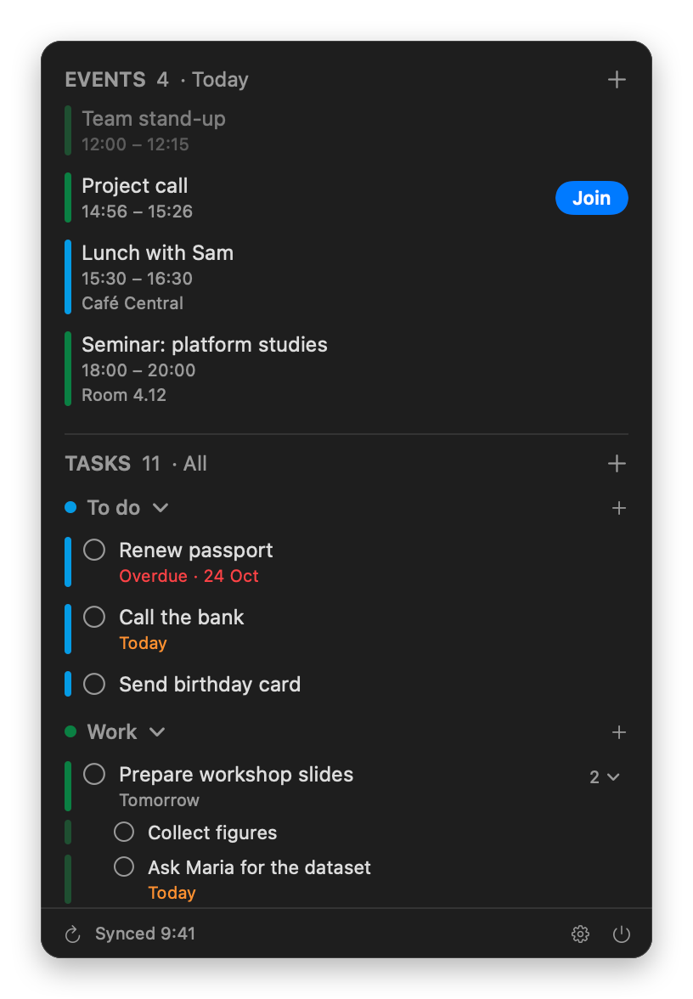
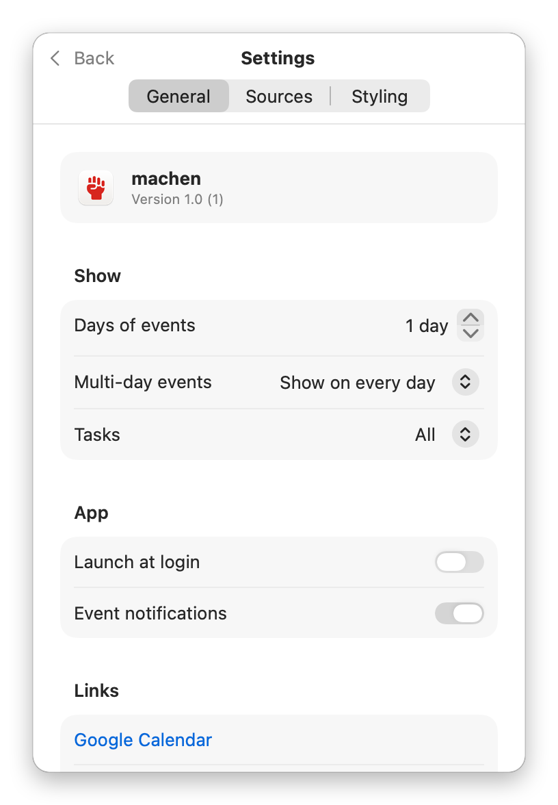
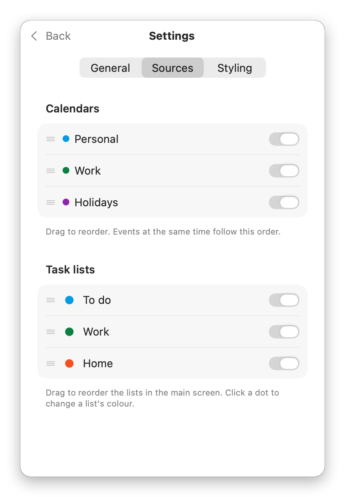
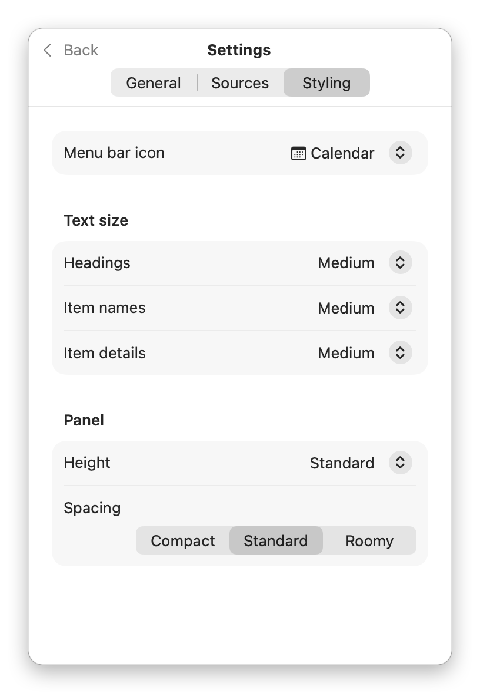

<p align="center">
  
</p>

# machen

machen is a small app for the Mac menu bar. It shows your Google Calendar events and your Google Tasks in one list, from one or more Google accounts, and lets you add and change them without opening a browser.

Website: [machen.polsys.net](https://machen.polsys.net)

<p align="center">
  
  
</p>

## What it does

- **Events:** shows the events of your Google calendars for today, or for up to two weeks ahead. Click the EVENTS heading to switch between today, 2 days, 3 days and a week.
- **Tasks:** shows your open tasks from Google Tasks, grouped by list and sorted by due date. Overdue tasks are marked in red, and subtasks appear under their task. You can fold a list or a task's subtasks away.
- **Editing:** add, edit and delete events and tasks, including subtasks, and create task lists. You can move an event to another calendar, and a task with its subtasks to another list. For repeating events, you choose whether a change applies to one event or to all of them.
- **Completing tasks:** click the circle next to a task to mark it as done. For a few seconds afterwards you can undo it.
- **Several accounts:** connect more than one Google account, for example a personal and a work account. Their events and tasks appear together in one list.
- **Video calls:** events with a Google Meet, Zoom, Teams, Webex or similar link get a **Join** button, in the list and in their notification. In the list, it's greyed out until 5 minutes before the start, but can be clicked at any time.
- **Notifications:** machen shows the reminders you've set in Google Calendar as Mac notifications.
- **Offline:** without a connection, machen shows the events and tasks it loaded last, up to four weeks ahead, and keeps showing their reminders. You can go on adding, changing and completing them: machen keeps your changes and sends them to Google as soon as you're online again. Changes not sent yet are marked with a small sync icon.
- **Your choice:** pick which accounts, calendars and task lists to show and in what order, the colour of each task list, text sizes, spacing, the height of the panel, and the menu bar icon.

<p align="center">
  
  
  
</p>

## What it doesn't do

- **Google only.** It works with Google accounts, not with iCloud, Outlook or other calendars.
- **No calendar grid.** Events are shown as a list, not as a week or month view, and there's no search.
- **No invitations.** You can't invite people to events, or accept or decline invitations. Declined events are shown crossed out.
- **No task reminders.** Notifications come only from calendar reminders, and only while machen is running. Reminders sent by email are left to Google.
- **Some limits come from Google:**
  - Tasks have a due date but no due time.
  - Subtasks can only be one level deep.
  - A single event of a repeating series can't be moved to another calendar; the whole series can.
  - Events and tasks can't be moved to another account.
  - A repeating task can't be moved to another list.
  - There's no "this and following events" option for repeating events.
- **Repeating series:** when you change a whole series, you can change its time and length, but not its days. To move a weekly meeting from Monday to Tuesday, use Google Calendar.
- **Completing a task also completes its subtasks**, as in Google's own apps.
- **Calendars you can only view**, such as holidays or calendars shared with you read-only, open in Google Calendar when you click an event.

## Installation

You need a Mac with Apple silicon (M1 or later) running macOS 14 (Sonoma) or later, and a Google account.

1. Download `machen-<version>.dmg` from the [latest release](https://github.com/bernorieder/machen/releases/latest).
2. Open it and drag **machen** into your **Applications** folder.
3. Open machen from Applications. Its icon appears in the menu bar; it's a calendar until you pick another one.
4. Click the icon, then **Sign in with Google**. Your browser opens: choose your account and allow access to your calendars and tasks. Then click the menu bar icon again.

With [Homebrew](https://brew.sh), instead of steps 1 and 2, run this in Terminal:

```
brew install bernorieder/machen/machen
```

To add another Google account, open **Settings → Sources** and click **Add Google Account**. If a calendar is shared with both accounts, machen shows it only once at first; you can switch on the second copy under **Calendars**.

To start machen whenever you log in, turn on **Settings → General → Launch at login**. When machen first wants to show a notification, macOS asks whether to allow it.

**Updating:** download the new version and drag it into Applications, replacing the old one. With Homebrew, run `brew upgrade machen`, then open machen again: Homebrew quits it to replace it. Your settings and sign-in are kept.

## Privacy

- **No server in between.** machen talks directly to Google from your Mac. It doesn't collect or send anything anywhere else.
- **Access to your data.** machen asks Google for permission to see your list of calendars, to see and change your events, and to see and change your tasks, because that's what it shows and edits. It can't share or delete calendars, or change who has access to them.
- **On your Mac.** Your sign-ins are stored in the macOS Keychain. A copy of the events and tasks it last loaded is kept on your Mac so it can show them offline, together with changes you made offline until they're sent. Removing an account in **Settings → Sources** removes its sign-in and its events and tasks.
- **Revoking access.** You can remove machen's access to your Google account at any time at [myaccount.google.com/permissions](https://myaccount.google.com/permissions).

The full [privacy policy](https://machen.polsys.net/privacy.html) has the details.

## Uninstalling

1. In machen, open **Settings → Sources** and click **Remove** next to each account. This removes your sign-ins and the saved events and tasks.
2. Quit machen and move it from Applications to the Trash. With Homebrew, run `brew uninstall machen` instead.

If you want to remove its settings too, delete the file `~/Library/Preferences/io.github.bernorieder.machen.plist`. With Homebrew, `brew uninstall --zap machen` removes the app and its settings together.

## Problems and ideas

Please open an issue on [GitHub](https://github.com/bernorieder/machen/issues).

## For developers

- [Building and releasing machen](docs/building.md): setting up a Google project, building, signing and notarizing.
- [How machen works](docs/how-it-works.md): sign-in, syncing, working offline, edits, notifications, and a map of the code.

## License

machen is released under the [MIT License](LICENSE).

## Credits

The fist in the app icon and menu bar is [hand-fist](https://fontawesome.com/icons/hand-fist?s=solid) from [Font Awesome Free](https://fontawesome.com), licensed under [CC BY 4.0](https://creativecommons.org/licenses/by/4.0/).
